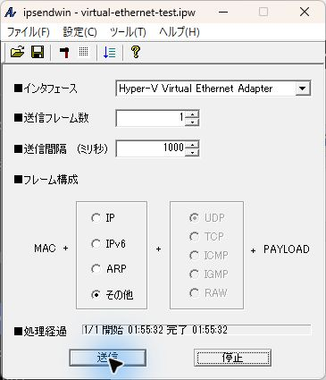

# ipsendwin / Npcap compatibility adapter

Windows 11でipsendwin 2.4が「送信可能なインタフェースがありません。」で停止する場合に試す、32ビットのアプリ専用互換DLLです。

解説記事：[ぬるま湯ハードウェア — Wireshark・ipsendwinの起動エラーとWindows 11での検証](https://yuyuyuroom.site/2024/11/04/wireshark-と-ipsendwin-の共存方法/)

配布：[GitHub Releases](https://github.com/matrizea/ipsendwin-npcap-compat/releases)

## 使い方

1. [Vector](https://www.vector.co.jp/soft/dl/win95/net/se363834.html)からipsendwin 2.4を入手します。
2. [Npcap公式サイト](https://npcap.com/)からNpcapを導入します。検証では1.90のWinPcap API互換モードを使いました。
3. ipsendwinを終了します。
4. ReleasesのZIPを展開し、その中の自作 `wpcap.dll` を `ipsendwin.exe` と同じフォルダーに置きます。
5. ipsendwinを起動し、使用するEthernetアダプターを選びます。自分が管理する検証環境で、送信数を1にして確認します。

このDLLはNpcap公式のDLLではありません。WindowsのSystem32・SysWOW64やNpcapのインストール先へ上書きしないでください。ZIPにはipsendwin本体・Npcap本体を含めていません。

## 何を回避するか

確認したipsendwin 2.4の起動処理は、Npcapから返された先頭インタフェースだけでIPv4を探します。このPCではIPv4を持たないWAN Miniportが先頭に列挙され、後続に利用可能な有線LANがあっても停止しました。

自作DLLは、Windowsシステムディレクトリ内の `Npcap/wpcap.dll` を絶対パスで読み込み、IPv4を持つ最初の非ループバックインタフェースをリストの先頭へ移します。他のインタフェースは残し、open・send・closeはインストール済みNpcapへ渡します。

元のipsendwin.exe、Windows側のDLL、アダプターの有効・無効、OSのセキュリティ設定は変更しません。IPv4を持つ非ループバックインタフェースが1つもない場合や、Npcapが壊れている場合の修復機能ではありません。

## 検証した範囲

2026年11月4日、Windowsビルド26300.9711 x64、Npcap 1.90（WinPcap互換モード）、ipsendwin 2.4（32ビット）で確認しました。

| 条件 | 結果 |
|---|---|
| Npcapなし | wpcap.dll不足のエラー |
| Npcap互換モードのみ | 「送信可能なインタフェースがありません。」 |
| 自作互換DLLを追加 | 操作画面の起動に成功 |
| Hyper-V仮想Ethernetへ1フレーム送信 | 別の32ビットプログラムで78バイトのフレームをキャプチャ |
| 保存先を変えて起動・設定を再読込 | 同じフレームの送信・キャプチャに再度成功 |

EtherTypeは `0x88B5`、ペイロードは64バイトのゼロ埋め、送信数は1です。



これは同じPCの仮想Ethernet上での確認です。物理LAN上の別端末への到達、全プロトコル、全Windows環境、Wiresharkとの同時動作は未検証です。

## 元に戻す

ipsendwinを終了して、EXEの隣に追加した自作 `wpcap.dll` だけを別の場所へ移します。

## ビルド

32ビットPEを生成できるMinGW GCC/binutilsを用意し、リポジトリのルートで実行します。

```powershell
.\source\build.ps1 -ToolchainBin 'C:\path\to\mingw\bin'
```

ルートへ `wpcap.dll` を出力します。DLLを使用中のipsendwinは先に終了してください。ソースに外部ダウンロード・ソフトの自動導入処理はありません。

`source/pcap-probe.cs` は切り分けに使った補助コードです。.NET FrameworkのC#コンパイラーで `/platform:x86` を指定してビルドしました。実行ファイルは互換DLLと別のフォルダーへ置き、通常のNpcapを読み込ませてください。

```text
pcap-probe.exe
pcap-probe.exe <device-name>
pcap-probe.exe <device-name> <output-file>
```

順に、インタフェース列挙、アダプターを開く確認、EtherType 0x88B5だけのキャプチャです。出力ファイルにはキャプチャした1フレームを書き込みます。キャプチャモードはEthernet用で、データリンク種別1のアダプターで使ってください。

## 配布DLLのSHA-256

```text
E6EB53499AF52AF6CE3175C31D0644A704F5D7646056724643FEBB1769206E40
```

配布DLLはこのWindows 11で動作確認した未署名の自作DLLです。
